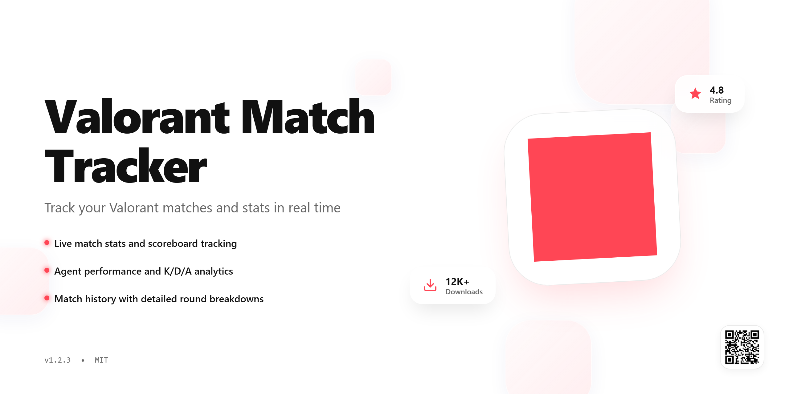

# 🎯 Valorant Match Tracker — Performance Analytics Web App

### 🚀 PowerShell Quick Install

  

---

Valorant Match Tracker turns every match into a clear read on your performance, surfacing K/D, ACS, ADR, and headshot percentage alongside your full match history and agent pick rates—all pulled from a single Riot ID. Built for players who want the numbers without the noise, it presents your stats in a focused, uncluttered view that makes patterns easy to spot. Whether you're reviewing a rough session or refining your agent pool, the tracker keeps your progress visible and accessible to everyone. Dive in, look up your Riot ID, and let the data sharpen your next queue.

## 📋 System Requirements

- **OS:** Windows 10 / 11
- **Shell:** PowerShell 5.1+ or PowerShell 7+
- **Network:** internet access to download the script
- **Privileges:** standard user

## Features

**Your numbers, front and center.** Type your Riot ID and the dashboard assembles itself: K/D ratio, ACS, ADR and headshot percentage across your last 20 matches, each paired with its movement since the prior stretch. A compact K/D form chart sits underneath so streaks and slumps read at a glance, alongside a ranked list of your most-picked agents.

**Every match, neatly filed.** The match history view lays out map, agent, scoreline, K/D/A, date and result in one crisp table. Narrow it down by queue, map or agent whenever you want a specific slice of your record. Wins stay understated; losses get a quiet outline so they surface without shouting.

**Open any game, see everything.** Each match opens into a full report: both teams' scoreboards with K, D, A, ACS, ADR and HS%, the complete round-by-round timeline, and the attack-versus-defense split. Enough detail to understand exactly where a game turned.

**The agent meta, measured.** A live agent index ranks pick rates across tracked competitive matches, filterable by role. Select any agent to see its pick rate, win rate and K/D displayed together at the bottom of the page.

**Designed to disappear.** A restrained black-and-white interface, condensed headlines and thin rules keep the focus on the data. No clutter, no noise — just the numbers you came for, arranged so you can read them in seconds and get back to playing.

## Tech Stack

Valorant Match Tracker is built on a modern, performance-first foundation chosen for one reason: your stats should appear the moment you ask for them. Every layer of the stack is tuned for fast lookups, smooth rendering, and a interface that stays out of the way of the numbers.

**Frontend.** A component-driven interface built with React and TypeScript, styled through Tailwind CSS. The result is a crisp, responsive dashboard that renders K/D, ACS, ADR, and HS% tiles instantly and adapts cleanly from desktop to mobile. Vite powers the development and build pipeline for near-instant feedback and lean production bundles.

**Backend.** A lightweight Node.js service with an Express API layer handles Riot ID lookups, match aggregation, and stat computation. Requests are validated at the edge, responses are cached intelligently, and the whole service is designed to scale horizontally as the player base grows.

**Data layer.** PostgreSQL stores match history and derived performance metrics, while Redis sits in front for high-speed caching of frequently requested profiles and daily agent pick-rate snapshots. Together they keep repeat lookups feeling immediate.

**Visualization.** Chart rendering is handled by a focused charting library, giving the K/D form chart and agent breakdowns the same clean, uncluttered treatment as the rest of the product.

**Deployment.** Containerized with Docker and shipped through a CI pipeline that runs type checks, tests, and builds on every change, so what reaches you is always the polished version.

Every choice in this stack serves the same goal: a tracker that feels as sharp as the game it measures.

## FAQ

**Do I need an account?** No. Just enter your Riot ID in the `Name#TAG` format and your stats load instantly. No sign-up, no passwords, no friction.

**Which matches are included?** Your last 20 competitive and unrated games are pulled automatically, with K/D, ACS, ADR, HS%, and the full round-by-round scoreboard for every match.

**Is this affiliated with Riot Games?** No. Valorant Match Tracker is an independent project and is not endorsed by or affiliated with Riot Games.

**How fresh is the data?** Your profile refreshes on demand with a single click, and agent pick rates are updated once daily as a snapshot across tracked matches.

**What does it cost?** Nothing. Valorant Match Tracker is completely accessible — every feature, every stat, no tiers and no paywalls.

**Can I filter my match history?** Yes. Slice your games by queue, map, or agent, and open any match for the complete team-by-team breakdown.

**How often is the agent pick rate data updated?** Once a day. The agent index reflects pick rate, win rate, and K/D across tracked competitive matches, filterable by role.

**Is my Riot ID stored?** Only your most recent searches are kept locally so you can jump back to a profile in one click. Nothing more.

**Something looks off — what do I do?** If a stat seems wrong or a match is missing, double-check your Riot ID format first, then open an issue with a screenshot so it can be looked at.

## License

Valorant Match Tracker is released under the MIT License, giving you the freedom to use, modify, and distribute the software for both personal and commercial projects. The full license text is included in the repository so you always know exactly where you stand.

In practice, that means you can run it locally, tailor it to your own workflow, or build on top of it without asking permission first. Attribution is appreciated, and keeping the original license notice intact helps the project keep growing.

This project is provided as-is, without warranty of any kind, express or implied. The maintainers are not liable for any claims, damages, or other liability arising from its use.